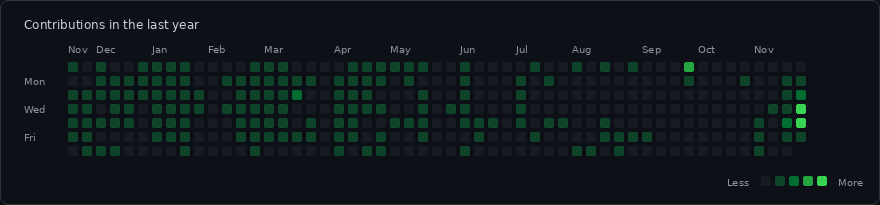

  <h1>Hi, I'm Maxim 👋</h1>
  
<strong>Application development apprentice building practical tools for software development.</strong>

  
<a href="https://github.com/mschr703/branchloom">Branchloom</a> · <a href="https://github.com/mschr703?tab=repositories">All repositories</a> · <a href="https://mschr.de">Website</a>

## About me

I'm an application development apprentice who enjoys building practical software and understanding how it works under the hood.

My main project is **Branchloom**: a local Windows app that brings project tasks, coding assistants, design drafts and code review into one workspace. It helps you take an idea through to a checked result while keeping you in control of what gets integrated.

## Featured project: Branchloom

- **Plan:** Capture ideas as notes or board tasks and organize work in configurable workflows.
- **Build:** Run installed coding assistants locally. Independent tasks can use separate Git worktrees.
- **Review:** Inspect sessions, code changes and test evidence before integrating a result.

Branchloom is an **early Windows preview**. [Explore the source](https://github.com/mschr703/branchloom) · [Get the latest release](https://github.com/mschr703/branchloom/releases/latest) · [Read the current status](https://github.com/mschr703/branchloom/blob/main/docs/STATUS.md)

## Also building

**[Jarvis Local](https://github.com/mschr703/jarvis-local-assistant)** — A German-language assistant for Windows with chat, document search, drafts, tasks and reminders in a local interface. It also has bounded PC and browser tools.

## Tools I use

TypeScript · JavaScript · Python · React · Electron · HTML/CSS · Git

## Contributions

## Contact

[Website](https://mschr.de) · [LinkedIn](https://www.linkedin.com/in/maxim-schreiner-05b463386) · [Email](mailto:contact@mschr.de)
